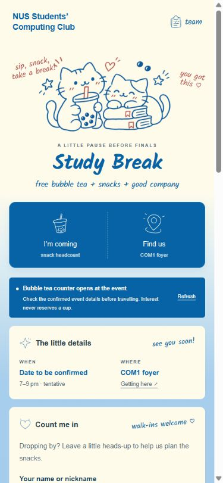

# Study Break

### NUS Students’ Computing Club

A mobile-friendly event website that helps organisers estimate snack demand, check people in, and manage a shared supply of **150 bubble teas**.

**[Live website](https://gilded-liger-22b522.netlify.app/) · [Try the volunteer practice desk](https://gilded-liger-22b522.netlify.app/#door) · [Security review](SECURITY.md)**

## The problem

An informal study-break event needs a food estimate without turning walk-ins away. At the door, volunteers need to count arrivals quickly and avoid handing out more drinks than the club has purchased.

Study Break keeps **interest, attendance, and cup claims separate**. Expressing interest helps plan food; it does not reserve bubble tea or guarantee attendance.

## What the website does

| For visitors | For organisers |
| --- | --- |
| View the event details and COM1 directions | Use large check-in buttons on a phone |
| Submit optional interest using a nickname | See shared interest, arrival, and cup totals |
| Check the public bubble-tea status | Enforce the 150-cup limit across connected devices |
| Walk in without a ticket or reservation | Pause/open check-in, undo the latest entry, and export private records |

The cream-and-blue café layout uses original doodle artwork, self-hosted lettering, and a compact card layout. Team access is in the top-right corner.

<details>
<summary>View the mobile interface</summary>

<p align="center"></p>

</details>

## Review the project

1. Open the [live website](https://gilded-liger-22b522.netlify.app/) and explore the event page.
2. Select **Team → Try practice mode**. No organiser code is needed for practice.
3. Tap **Check in + give a cup**. The practice desk shows one arrival and 149 cups remaining.
4. Try a check-in without a cup, Undo, and Reset practice. Practice never changes the live event.
5. To test the interest form with sample names, use the isolated local preview below.

The event date is **to be confirmed**. The displayed 7–9 pm time is tentative. Live organiser access is restricted; production access details are not part of this submission.

## Run locally

Use **Node.js 20 or newer**. Preview and tests use Node’s built-in modules, so no dependency installation or cloud account is needed for these steps.

```sh
git clone https://github.com/jesslynsong/study-break.git
cd study-break
node serve.mjs
```

Open **http://localhost:4183**. The preview uses an isolated in-memory event that resets when the server restarts. If you want to explore its live-dashboard flow, the development-only code is `local-preview-organiser-code-2026`; it is not accepted by the deployed website.

Run the automated checks:

```sh
node --test
```

Tests cover the cup limit, simultaneous final-cup claims, safe retries, organiser access, private exports, invalid backups, and storage failures. [TESTING.md](TESTING.md) records browser checks and their scope.

## Technical approach

| Layer | Implementation |
| --- | --- |
| Interface | HTML, CSS, and browser JavaScript modules |
| API | Netlify Functions with server-side validation and organiser authentication |
| Shared data | Netlify Blobs with strong reads and conditional writes |
| Offline shell | Service worker; live/private API responses are excluded from its cache |
| Hosting | Netlify |

Each write checks the current storage revision before it is saved. A conflicting write is retried against fresh data, so two phones cannot both claim the final cup. Repeated requests use the same operation reference to avoid double-counting after a lost confirmation.

Netlify Blobs was chosen to keep hosting, functions, and a small event database together. **Live check-in needs an internet connection.** If storage or connectivity fails, the interface pauses live changes and asks volunteers to reconnect. Organisers should keep a paper tally during an outage and reconcile it before resuming.

## Scope and limitations

- Interest is a planning estimate. Nicknames are not verified identities, and duplicate responses across browsers remain possible.
- The public cup banner refreshes periodically; it is a snapshot, not a reservation.
- Volunteers still need a hand mark or wrist stamp to prevent repeat physical cup claims.
- This version has no automated Telegram messages, attendee accounts, or cup reservations.
- The public form has basic validation and a honeypot, not a full anti-abuse service. Development-tool dependency advisories are recorded in [SECURITY.md](SECURITY.md).

## Repository guide

- [public/](public/) — event page, interest form, volunteer desk, and visual assets
- [server/](server/) — event rules, shared storage, authentication, and exports
- [netlify/functions/](netlify/functions/) — hosted API entry point
- [tests/](tests/) — automated checks
- [Organiser guide](docs/OPERATIONS.md) — deployment and event-night instructions
- [Security review](SECURITY.md) — public-sharing checks, access boundaries, and remaining limitations
- [Design notes and asset credits](DESIGN-NOTES.md) — illustration provenance and font licence

The public repository contains source code and an **unconfigured organiser-verifier placeholder**. Live organiser credentials, event records, private backups, and hosting credentials are excluded. Deployment requires the private setup described in the organiser guide.
